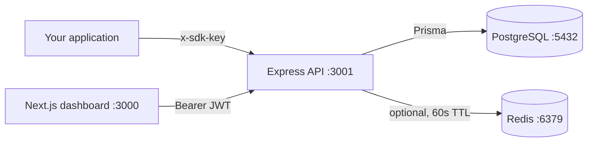
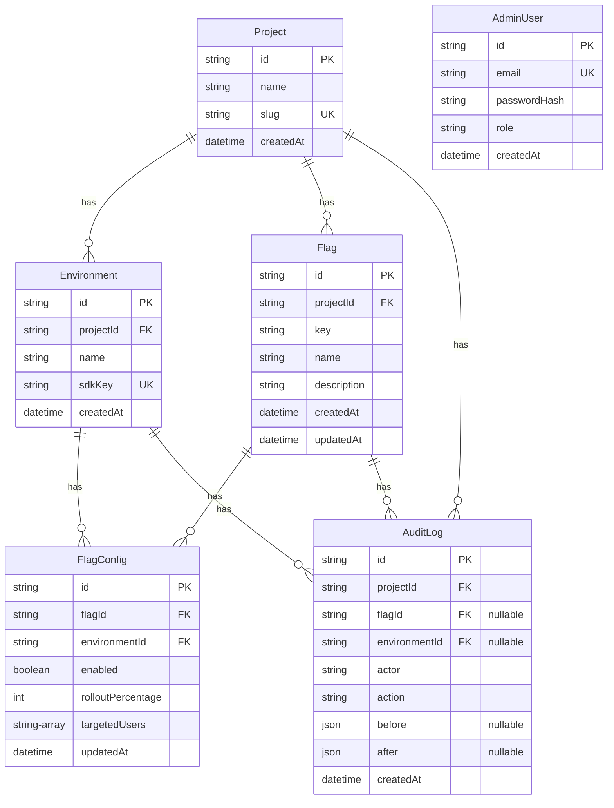
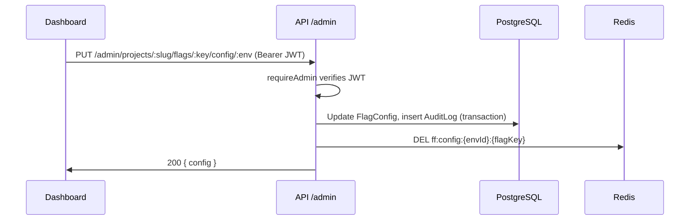
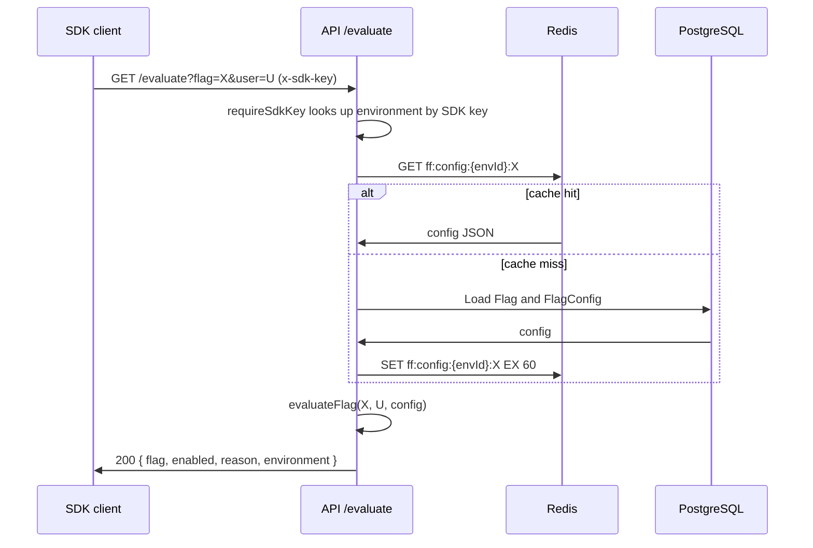

# Architecture

## Overview

The platform has three parts: an Express API, a Next.js dashboard, and a
PostgreSQL database. Redis is an optional cache in front of the database
for flag configs.

## Components

### API (`apps/api`)

Node.js 20, TypeScript in strict mode, Express 4. The entry point is
`src/index.ts`: it wires CORS and a 256 KB JSON body limit, a request
logger that skips `/evaluate` paths, the `/health` endpoint, the admin
router under `/admin`, the SDK router at the root, a JSON 404 handler, and
a central error handler that never leaks stack traces.

On startup `main()` initialises the Redis cache, then connects to
PostgreSQL with `prisma.$connect()`. If the database is unreachable the
process exits with an error. That is deliberate: the API is useless
without the database, and a crash loop is louder than silent 500s.

### Dashboard (`apps/web`)

Next.js 14, React 18, Tailwind CSS 3. Three pages:

- `/` redirects to `/flags`.
- `/login`: admin login. The JWT is stored in `localStorage` under
  `ff_admin_token`. The page shows the demo seed credentials.
- `/flags`: project and environment switcher, flag cards with toggle,
  rollout slider, and targeted user editor, plus flag creation and
  deletion. The selected project slug is kept in `localStorage` under
  `ff_project_slug`.
- `/audit`: audit log table with flag and environment filters and a limit
  selector (default 50), and expandable before and after JSON.

All API calls go through the typed client in `apps/web/lib/api.ts`. It
attaches the Bearer token when one is stored and throws an `ApiError`
with the status and the server's error message.

### Database (`apps/api/prisma/schema.prisma`)

PostgreSQL via Prisma 5. The initial migration is
`prisma/migrations/0001_init/migration.sql`.

Rules enforced by the schema:

- A project slug is unique. An environment name is unique within its
  project. A flag key is unique within its project.
- Each flag has exactly one `FlagConfig` per environment (unique on
  flag and environment).
- Deleting a project cascades to its environments, flags, configs, and
  audit rows. Deleting a flag sets `flagId` to null on its audit rows,
  so the `flag.deleted` entry stays readable.
- `Environment.sdkKey` is a unique 48 character hex string, generated
  with `crypto.randomBytes(24)`.

### Cache (`apps/api/src/lib/cache.ts`)

Redis is optional. `initCache` connects when `REDIS_URL` is set and the
server answers a ping; otherwise it logs a warning and the API runs
entirely without cache. Reads fall through to PostgreSQL and cache
writes become no-ops.

- Key format: `ff:config:{environmentId}:{flagKey}`.
- Value: the flag config as JSON (`enabled`, `rolloutPercentage`,
  `targetedUsers`).
- TTL: 60 seconds, set on cache-through population after a database read.
- Invalidation: config updates and flag deletions delete the affected
  keys immediately, so SDK reads pick up the new value without waiting
  for the TTL.

Per-user evaluation results are never cached. Caching them would break
rollout behaviour when percentages change.

## Request flows

### Admin: update a flag config

### SDK: evaluate a flag

## Evaluation rules

Implemented in `apps/api/src/lib/evaluate.ts`, in priority order:

1. Config disabled: `{ enabled: false, reason: "disabled" }`.
2. User in `targetedUsers`: `{ enabled: true, reason: "targeted" }`.
3. Rollout: `sha256(flagKey + ":" + userId)`, first 8 hex chars as a
   32 bit integer, modulo 100, is below `rolloutPercentage`:
   `{ enabled: true, reason: "rollout" }`.
4. Otherwise: `{ enabled: false, reason: "default" }`.
5. No user supplied: targeting and rollout are skipped and the master
   switch decides: `{ enabled: true, reason: "no-user" }` when enabled.

The bucket is deterministic: the same flag and user always hash to the
same bucket, so a rollout is stable across requests and restarts. Different
flags hash independently, so rollouts are not correlated across flags.

## Authentication

- Admin: `POST /admin/login` checks the email and bcrypt password hash,
  then signs a JWT with `JWT_SECRET` (12 hour expiry). Every other admin
  route uses the `requireAdmin` middleware, which expects
  `Authorization: Bearer <token>`. The token payload is `{ sub, email,
  role }` and the role is always `admin` in this version.
- SDK: the `x-sdk-key` header must match an `Environment.sdkKey`. The key
  identifies the environment and its project. SDK callers never see admin
  credentials or other environments' configs. A missing key returns 401
  with `missing x-sdk-key header`; an unknown key returns 401 with
  `invalid sdk key`.

## Deployment shape

Docker Compose runs four services: `postgres` (PostgreSQL 16),
`redis` (Redis 7), `api` (Node 20 slim, runs `prisma migrate deploy`
then `node dist/index.js`), and `web` (Next.js standalone output on
port 3000). The API Dockerfile builds with `npm ci`, generates the Prisma
client, and compiles TypeScript; the runtime image copies the compiled
output and the Prisma files. The web Dockerfile builds with
`NEXT_PUBLIC_API_URL` baked in as a build argument (default
`http://localhost:3001`) and serves the standalone output.

Note: the Docker images and `docker compose up` were never run in the
environment where this was built (no Docker daemon there), and the
migration was never applied to a real database there. Treat the
Dockerfiles and the Compose file as untested until run on a machine with
Docker. See the verification notes in the README.
